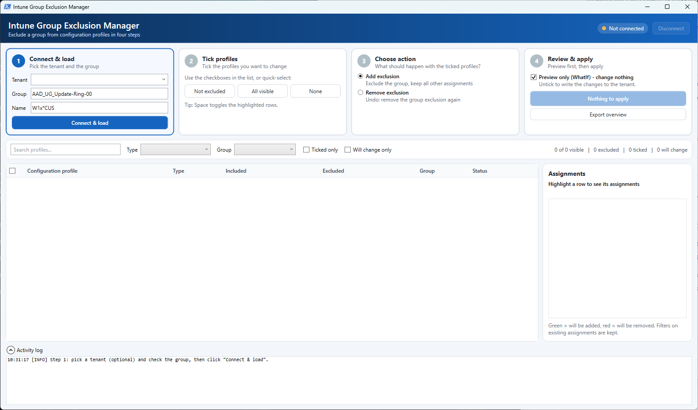

# Intune Group Exclusion Manager

A PowerShell/WPF tool to **exclude a group from many Microsoft Intune configuration profiles at once**, and to undo it again. You can preview every change first, and nothing else on the assignments changes.



## Why

Sometimes one group has to be kept away from a large set of configuration profiles. A typical example is a pilot or update ring group such as `AAD_UG_Update-Ring-00`. In the Intune portal you have to open every profile, go to *Assignments*, add the exclusion and save. With dozens of `W1x - ... - CUS - ...` profiles that is slow and easy to get wrong.

This tool lists the profiles you filter on and shows who is included and excluded on each one. You tick the profiles, and it adds (or removes) the exclusion for you through Microsoft Graph. All other assignments and filters are kept.

## Features

- **Guided four-step flow:** each step card turns blue when it's your turn and green with a tick when it's done.
  1. **Connect & load:** pick the tenant, the group and a name filter.
  2. **Tick profiles** in the list, or quick-select *Not excluded* / *All visible*.
  3. **Choose action:** *Add exclusion* or *Remove exclusion* (undo).
  4. **Review & apply:** preview first, then apply.
- **Name filter before loading:** only profiles whose name matches are loaded, for example `CUS` or `W1x*CUS` (`*` is a wildcard). Leave it empty to load everything.
- **Fast loading:** names are read first (id and name only), then the assignments of the matching profiles are read in Graph batches of 20. Throttled requests are retried automatically.
- **All configuration profile types:** Templates (`deviceConfigurations`), Settings Catalog (`configurationPolicies`) and Administrative Templates (`groupPolicyConfigurations`).
- **Clear overview per profile:** the included and excluded groups (with filter type) and the state of the chosen group: *Not assigned*, *Excluded* (green dot) or *Included* (red dot).
- **Rows that will change turn green:** a green row with a green accent bar means "this profile will really be changed". Ticked rows that need no change turn grey, rows with an error turn red, and profiles you've already updated turn dark green.
- **Assignments panel:** highlight a row to see all of its assignments, with the exclusion that will be added in green and the one that will be removed in red and struck through.
- **Safe by default:**
  - *Preview only (WhatIf)* is on at start-up.
  - The apply button says exactly what it will do, for example "Preview 12 changes" or "Apply 12 changes".
  - A real run asks for confirmation first.
  - Profiles where the group is **included** are never changed. A group can't be both included and excluded.
  - Existing assignments, including assignment filters, are always kept. The Graph `/assign` action replaces the full set, so the tool sends the current set plus or minus the exclusion only.
  - After each change the assignments are read back from Intune, so the list shows what was really stored.
- **Audit log:** every real run is saved automatically to `Logs\GroupExclusionChanges_<tenant>_<timestamp>.csv`, with the excluded groups before and after.
- **Interactive browser sign-in:** the tool opens the normal Microsoft sign-in page in your default browser, so MFA and Conditional Access apply as usual. It doesn't use device code flow, and it avoids the Windows sign-in broker (WAM) issues of background threads. The access token is renewed automatically during long sessions.
- **Remembers your settings:** the last group, the last name filter and the 10 most recent tenants are stored in `%LOCALAPPDATA%\IntuneGroupExclusionManager`.
- **Filters:** free-text search, type, group state, ticked only and will change only.
- **Multi-tenant:** *Disconnect* signs you out and clears everything, so you can connect to another tenant.
- **Progress bar** while loading, and a CSV export of the overview and the session log.

## Requirements

| Requirement | Details |
|---|---|
| OS | Windows (WPF) |
| PowerShell | Windows PowerShell 5.1 or PowerShell 7.x |
| Module | `Microsoft.Graph.Authentication` |
| Permissions | An account that can manage Intune configuration profiles and read groups |

```powershell
Install-Module Microsoft.Graph.Authentication -Scope CurrentUser
```

### Microsoft Graph permissions

The tool signs in interactively (delegated) with the *Microsoft Graph Command Line Tools* app and asks for these scopes:

- `DeviceManagementConfiguration.ReadWrite.All`: read profiles and change their assignments
- `Group.Read.All`: find the group and show group names in the overview

If admin consent hasn't been given for these scopes yet, the sign-in page asks for it. The activity log warns you when the token is missing one of them.

It uses the Graph **beta** endpoint for the Intune objects, because Settings Catalog and Administrative Templates are only fully available there.

## Getting started

```powershell
# Optional: unblock the file after downloading it
Unblock-File .\Set-IntuneGroupExclusionGUI.ps1

# Start with the defaults
.\Set-IntuneGroupExclusionGUI.ps1

# Start with a specific group, name filter and tenant
.\Set-IntuneGroupExclusionGUI.ps1 -GroupName 'AAD_UG_Update-Ring-00' -NameFilter 'W1x*CUS' -TenantId 'contoso.onmicrosoft.com'
```

| Parameter | Default | Description |
|---|---|---|
| `-GroupName` | `AAD_UG_Update-Ring-00` | Display name of the Entra ID group to exclude |
| `-NameFilter` | `W1x` | Only load profiles whose name contains this text (`*` = wildcard) |
| `-TenantId` | *(empty)* | Tenant ID or domain. Empty = the tenant of the account you sign in with |

If PowerShell isn't running in STA mode, the script restarts itself with `-STA` automatically.

## Usage

1. **Connect & load:** check the group and the name filter, optionally pick a tenant, and click **Connect & load**. Sign in in the browser tab that opens, then return to the tool. The matching profiles and their assignments are loaded.
2. **Tick profiles:** tick the checkbox in front of each profile you want to change. You can also:
   - click **Not excluded** to tick every visible profile where the group isn't assigned yet;
   - click **All visible** after filtering;
   - use the header checkbox to tick everything visible;
   - press **Space** to toggle the highlighted rows.
3. **Choose action:**
   - **Add exclusion** adds the group as an exclusion and keeps all other assignments.
   - **Remove exclusion** removes the exclusion again, for example to undo an earlier run.

   Ticked rows that will really change turn **green**. Highlight a row to see the result in the *Assignments* panel.
4. **Review & apply:**
   - Click **Preview N changes** with *Preview only (WhatIf)* on, and review the activity log.
   - Then untick WhatIf, click **Apply N changes** and confirm.
   - Updated rows turn dark green, failed rows turn red, and an audit log is saved.

## Command-line alternative

`Set-W1xProfileExclusion.ps1` does the same without a GUI. It adds the exclusion to every profile whose name matches a regex, and supports `-WhatIf`:

```powershell
.\Set-W1xProfileExclusion.ps1 -WhatIf
.\Set-W1xProfileExclusion.ps1 -GroupName 'AAD_UG_Update-Ring-00' -NamePattern '^W1x\s*-.*- CUS -'
```

## Notes and limitations

- Only configuration profiles are covered. Platform scripts, remediations, compliance policies, Endpoint Security policies, update rings and apps are not.
- Profiles are matched **by name** with the name filter. Renamed profiles need a matching name.
- A profile where the group is *included* is skipped and shown as *Group is INCLUDED - skipped*. Fix those by hand if needed.
- Assignment filters on existing assignments are kept. Exclusions themselves can't have a filter in Intune.
- The sign-in uses a temporary `http://localhost` port to receive the answer from the browser. Local security software must allow that.

## Disclaimer

Use at your own risk. Always run a WhatIf preview first, and test in a non-production tenant before changing production.
